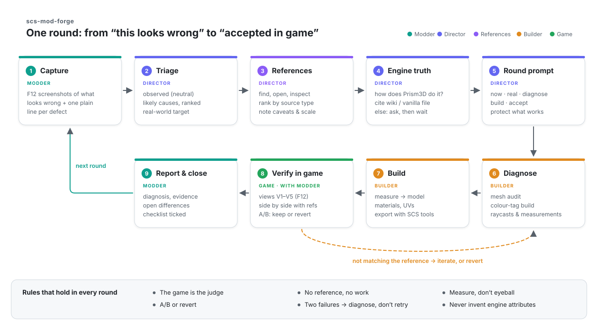

# scs-mod-forge

**A reference-locked, AI-assisted method for building realistic Euro Truck Simulator 2 / American Truck Simulator mods with Blender.**

This repository documents a workflow that was battle-tested while rebuilding a **Honda Civic Sedan 2020 (10th gen, 1.5 VTEC Turbo, 6MT)** interior, exterior and driving physics for ETS2. In that workflow:

- an **AI coding agent** (Claude Code) drives **Blender** through an MCP server;
- a separate **research/direction assistant** turns screenshots and real-world references into precise, verifiable work orders;
- **the game is the only judge**: every change is accepted only when an in-game screenshot matches a real photo.

It is not a plugin and not a magic button. It is an *architecture for collaboration*: roles, artifacts, loops and rules that keep an AI agent honest and turn "make it look realistic" into a sequence of measurable steps.

> Not affiliated with or endorsed by SCS Software. "Euro Truck Simulator 2", "American Truck Simulator", "Prism3D" and vehicle brand names belong to their owners. Respect copyright: reference photos are for **looking at**, not for redistributing inside your mod.

---

## Why this exists

If you ask an AI agent connected to Blender to "make the interior realistic", you will get something that looks fine in a Blender viewport and wrong in the game. We hit every variant of that failure:

| What the agent said | What the game showed |
|---|---|
| "Rear-view mirror implemented" | black glass, then the road **in front**, then a ghost frame from an inherited accessory |
| "Fixed the A-pillar" | sawtooth spikes from concave n-gons triangulated at export |
| "Added the windshield frit band" | nothing; the dashboard looked like it was floating |
| "Cluster layout matches the reference" | range and fuel-economy text drawn on top of the speed |

The fixes were not "better prompts" in general. They were **structural**:

1. **Reference-locked work**: every component has real photos, measured proportions and a written description of what the real part looks like *and* what is wrong now.
2. **Engine-truthful constraints**: Prism3D mods cannot run code. Every requirement is translated into what the engine actually supports (bone animations, dashboard UI element IDs, the lamp mask system, mirror cameras, FMOD banks), with documentation links instead of invented attributes.
3. **In-game verification loop**: fixed camera views (V1–V5), screenshots from the game, side-by-side with the reference, A/B before/after, and a revert if "after" is not clearly better.
4. **Deterministic diagnostics**: color-tagging meshes in a diagnostic build to find which file produces a broken pixel, raycast scripts to measure gaps, OpenCV to measure parts from photos.

---

## Architecture at a glance

<picture>
  <source media="(prefers-color-scheme: dark)" srcset="docs/assets/architecture-dark.svg">
  
</picture>

**How to read it.** The diagram has three horizontal layers:

- **Truth** (top): where facts come from. The Director consults the real vehicle, real-world references and engine documentation (dashed arrows) before it asks for anything. The game itself produces the last kind of truth: what actually renders and drives.
- **Roles** (middle): four actors, left to right in the order work flows. Each has one job it is good at and a few things it must never do.
- **Artifacts** (bottom): what each role hands over. Every artifact is a file you can open, review and keep.

The numbered arrows are one **round**:

1. The **Modder** reports what looks wrong, with screenshots.
2. The **Director** gathers and inspects real references, and checks what the engine can do.
3. The Director hands the Builder **one round prompt**: what is wrong now, how the real part looks, how to build it within engine limits, and how to prove it.
4. The **Builder** (Claude Code + Blender MCP) diagnoses, builds and exports the mod.
5. The **Game** renders the agreed views (V1–V5).
6. The Modder sends the **F12 screenshots** back to the Builder.
7. The Builder compares them with the references. It **iterates, or reverts** if the change isn't clearly better.

Steps 4 → 7 repeat until the screenshots match. Nothing is accepted on the strength of a Blender render.

<picture>
  <source media="(prefers-color-scheme: dark)" srcset="docs/assets/round-loop-dark.svg">
  
</picture>

Full explanation: **[docs/01-architecture.md](docs/01-architecture.md)** · stage by stage: **[docs/02-round-workflow.md](docs/02-round-workflow.md)**

---

## The loop in one paragraph

The modder plays, takes screenshots of what looks wrong and says why. The **Director** diagnoses each issue, finds the best real references (OEM press photos, owner's-manual diagrams, close-ups, night shots, independent measurements), checks what Prism3D can actually do, and writes **one round prompt**: what is wrong now, how the real part looks, how to build it inside engine limits, and how to prove it works. The **Builder** (Claude Code + Blender MCP) executes. It measures from photos instead of eyeballing, uses diagnostic builds instead of guessing, exports, and asks the modder for specific in-game screenshots. It is done only when the screenshots match the references. Then the next round starts.

---

## Documentation

| # | Document | What you get |
|---|---|---|
| 01 | [Architecture](docs/01-architecture.md) | Roles, artifacts, data flow, why the split exists |
| 02 | [The round workflow](docs/02-round-workflow.md) | Step-by-step lifecycle of one round, from screenshot to accepted change |
| 03 | [Reference hunting](docs/03-references.md) | Where to find references, how to rank them, measuring from photos, licensing |
| 04 | [Writing round prompts](docs/04-round-prompts.md) | Anatomy of a prompt that an agent cannot "pass" without doing the work |
| 05 | [Prism3D constraints](docs/05-prism3d-constraints.md) | What mods can and cannot do, the systems you will touch, with SCS wiki links |
| 06 | [Verification](docs/06-verification.md) | Standard views, A/B rule, overlays, color-tag diagnostics, telemetry |
| 07 | [Failure catalog](docs/07-failure-catalog.md) | Symptom → cause → fix for every problem we hit |
| 08 | [Physics calibration](docs/08-physics-calibration.md) | Calibrating performance against measured road-test data |
| 09 | [Sound](docs/09-sound.md) | Recording a real car, legal sources, input spec, FMOD bank pipeline |

## Templates

- [`templates/round-prompt.md`](templates/round-prompt.md): fill-in skeleton for a round
- [`templates/reference-table.md`](templates/reference-table.md): reference table with ranking columns
- [`templates/acceptance-checklist.md`](templates/acceptance-checklist.md): what must be true before a round is closed
- [`templates/diag-colors.md`](templates/diag-colors.md): color-tag diagnostic log
- [`templates/CLAUDE.md`](templates/CLAUDE.md): standing rules to drop into your mod project for Claude Code

## Tools

Plain Python (`pip install -r tools/requirements.txt`):

| Tool | Purpose |
|---|---|
| [`tools/photo_measure.py`](tools/photo_measure.py) | Perspective-correct a reference photo and extract contours + relative dimensions |
| [`tools/compare_images.py`](tools/compare_images.py) | Side-by-side, 50/50 overlay and diff heat-map of a screenshot vs a reference |
| [`tools/gear_table.py`](tools/gear_table.py) | Speed/RPM table from gear ratios, final drive and tyre size |
| [`tools/perf_from_telemetry.py`](tools/perf_from_telemetry.py) | Extract 0–100, 60–100, 80–120… times from a time/speed CSV |
| [`tools/check_wav.py`](tools/check_wav.py) | Validate audio recordings against the sound input spec |

Blender (run inside Blender, by hand or through the MCP server):

| Script | Purpose |
|---|---|
| [`tools/blender/mesh_audit.py`](tools/blender/mesh_audit.py) | Report non-manifold edges, concave n-gons, flipped normals, zero-area faces, loose geometry |
| [`tools/blender/diag_color_tag.py`](tools/blender/diag_color_tag.py) | Assign unique flat colors to selected objects and write the color map |
| [`tools/blender/gap_raycast.py`](tools/blender/gap_raycast.py) | Measure gaps between two surfaces (e.g. dashboard ↔ windshield) along an edge |
| [`tools/blender/eye_line.py`](tools/blender/eye_line.py) | Project a contact line from the driver's eye onto glass (e.g. frit band height) |

## Worked example

[`examples/civic-fc/`](examples/civic-fc/README.md) contains the real round prompts from the Civic project (in Romanian, the language the project was run in) and a round-by-round case study (in English) of what was asked, what failed and what changed in the method.

---

## Quick start

1. **Set up the Builder.** Install Blender, [SCS Blender Tools](https://modding.scssoft.com/wiki/Documentation/Tools/SCS_Blender_Tools), a Blender MCP server, and Claude Code. Connect Claude Code to Blender through MCP.
2. **Drop [`templates/CLAUDE.md`](templates/CLAUDE.md) into your mod project.** It encodes the non-negotiable rules: engine truth, no invented attributes, in-game verification, revert-if-not-better.
3. **Extract the vanilla game data** you will imitate, using SCS's extractor. Patterns from vanilla trucks are your syntax reference.
4. **Run round 1.** Take screenshots of what is wrong, gather references ([docs/03](docs/03-references.md)), and write the round with [`templates/round-prompt.md`](templates/round-prompt.md).
5. **Close the round only with the [acceptance checklist](templates/acceptance-checklist.md).**

## Principles (the short version)

1. **The game is the judge.** Blender renders are drafts.
2. **No reference, no work.** Every component gets real photos *before* modeling.
3. **Measure, don't eyeball.** Proportions come from photos and published dimensions.
4. **Say what the engine can do.** No invented `.sii` attributes; cite vanilla files or the wiki.
5. **Diagnose with evidence.** Color-tag builds, raycasts, overlays. Never "probably".
6. **A/B or revert.** A change that is not clearly better is undone.
7. **The owner of the real thing has the last word.** Specs from the internet are hypotheses until the modder confirms them on the real vehicle.

## License

Code and docs: [MIT](LICENSE). Third-party images are only **linked**, never included. Their copyright stays with their owners.
