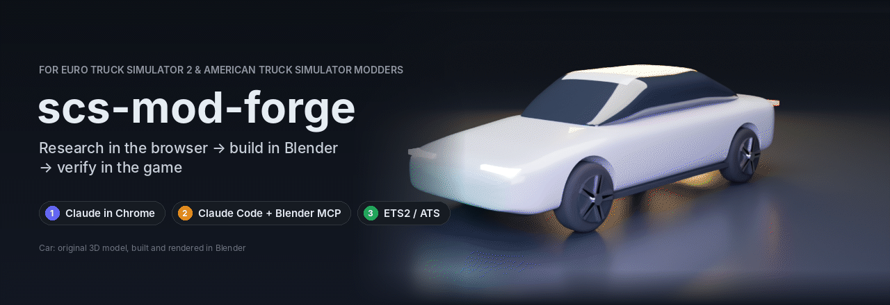
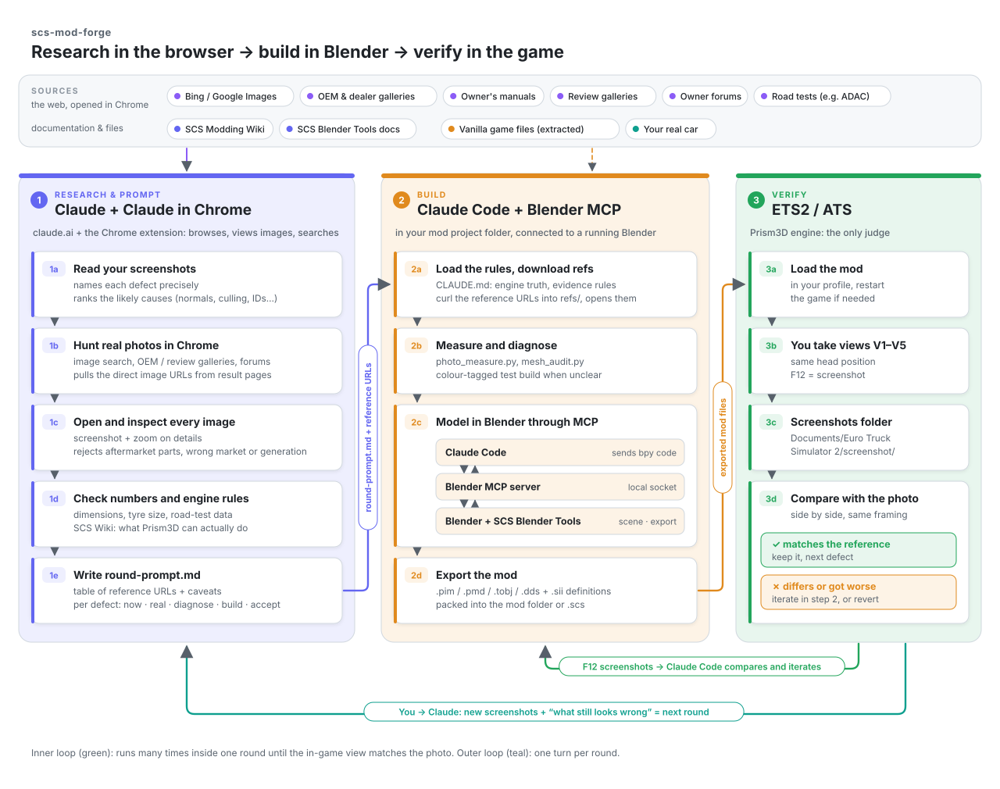
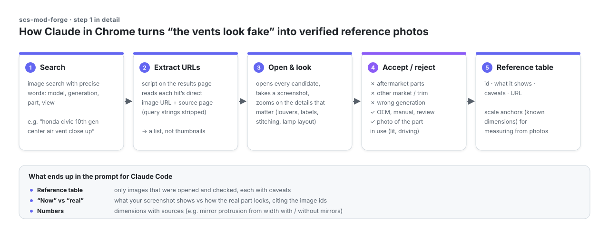

# scs-mod-forge

**Build realistic Euro Truck Simulator 2 / American Truck Simulator mods with two Claude agents: one that researches real photos in your browser, one that builds in Blender.**

| Step | Who | Does what |
|---|---|---|
| **1 · Research & prompt** | **Claude + Claude in Chrome** | Looks at your in-game screenshots, searches the web for **real photos** of the part, opens and inspects each one, checks dimensions and engine rules, and writes a precise **prompt** |
| **2 · Build** | **Claude Code + Blender MCP** | Reads the prompt, downloads the reference photos, measures them, models the part in **Blender** through MCP and exports the mod |
| **3 · Verify** | **ETS2 / ATS** | You take screenshots in the game. A change counts only when the screenshot matches the real photo |

The method was battle-tested while rebuilding a **Honda Civic Sedan 2020 (10th gen, 1.5 VTEC Turbo, 6MT)** for ETS2: interior, exterior details and driving physics.

> Not affiliated with or endorsed by SCS Software or Honda. "Euro Truck Simulator 2", "American Truck Simulator", "Prism3D" and vehicle brand names belong to their owners. Reference photos are only **looked at and linked**, never redistributed inside a mod.

---

## Architecture

<picture>
  <source media="(prefers-color-scheme: dark)" srcset="docs/assets/architecture-dark.svg">
  
</picture>

### How to read the diagram

**Top band: sources.** Everything the agents know comes from here. Claude in Chrome opens real web pages (image search, OEM and review galleries, owner's manuals, forums, road tests) and the SCS documentation. Claude Code reads the vanilla game files you extracted. Your own car outranks everything when you can measure it.

**① Research & prompt: Claude + Claude in Chrome.** You give Claude your screenshots and say what looks wrong.

| | |
|---|---|
| **1a** | It names each defect precisely and ranks the likely causes |
| **1b** | It searches for real photos **in your Chrome**, using the browser extension |
| **1c** | It opens every candidate image and zooms in. It throws out aftermarket parts, other markets and other generations |
| **1d** | It checks numbers (dimensions, tyre size, measured performance) and what Prism3D can actually do |
| **1e** | It writes **`round-prompt.md`**: a table of verified photo URLs, plus, for each defect, *what's wrong now · what the real part looks like · how to diagnose · how to build · how to prove it* |

**② Build: Claude Code + Blender MCP.** You paste the prompt into Claude Code, running in your mod project.

| | |
|---|---|
| **2a** | It follows the project rules (`CLAUDE.md`) and downloads the photo URLs into `refs/` |
| **2b** | It measures parts from the photos and diagnoses with scripts instead of guessing |
| **2c** | It models in Blender through the **Blender MCP server**: Claude Code sends Python (`bpy`) commands to the running Blender |
| **2d** | It exports with **SCS Blender Tools** into your mod |

**③ Verify: ETS2 / ATS.** You load the mod and take the screenshots Claude Code asks for (fixed views V1–V5, `F12`). Claude Code puts each one **next to the real photo**:
- if it matches, keep the change;
- if it differs or got worse, iterate or revert.

**The two loops.**
- 🟢 **Inner loop:** steps 2 → 3 → 2, many times inside one round, until the game matches the photo.
- 🔵 **Outer loop:** once per round. You bring new screenshots and "what still looks wrong" back to Claude in Chrome, and the next prompt starts.

Why it's split this way, and where mistakes get caught: **[docs/01-architecture.md](docs/01-architecture.md)**.

### Step ① up close

<picture>
  <source media="(prefers-color-scheme: dark)" srcset="docs/assets/research-step-dark.svg">
  
</picture>

Playbook with the exact techniques: **[docs/10-research-with-claude-in-chrome.md](docs/10-research-with-claude-in-chrome.md)**. Build-side setup and usage: **[docs/11-build-with-claude-code-and-blender-mcp.md](docs/11-build-with-claude-code-and-blender-mcp.md)**.

---

## Why this exists

Ask an AI agent connected to Blender to "make the interior realistic" and you get something that looks fine in the viewport and wrong in the game. We hit every variant of that:

| What the agent said | What the game showed |
|---|---|
| "Rear-view mirror implemented" | black glass, then the road **in front**, then a ghost frame from an inherited accessory |
| "Fixed the A-pillar" | sawtooth spikes from concave n-gons triangulated at export |
| "Added the windshield frit band" | nothing; the dashboard looked like it was floating |
| "Cluster layout matches the reference" | range and fuel-economy text drawn on top of the speed |

What fixed it was **structure**, not cleverer wording:

1. **Real photos first.** Claude in Chrome finds and *inspects* real photos before anything is modeled, so the builder never works from memory.
2. **Engine truth.** Prism3D mods cannot run code. Every requirement is phrased in what the engine supports (bone animations, dashboard UI IDs, the lamp mask system, mirror cameras, FMOD banks), with documentation links.
3. **The game is the judge.** Fixed views, screenshots next to the photos, A/B before/after, revert if not better.
4. **Evidence-based diagnosis.** Colour-tagged test builds, raycasts and photo measurements instead of "probably".

---

## Quick start

1. **Research side:** install [Claude in Chrome](https://claude.ai/chrome) and use it with Claude, so Claude can browse and look at images in your browser.
2. **Build side:** install Blender, [SCS Blender Tools](https://modding.scssoft.com/wiki/Documentation/Tools/SCS_Blender_Tools), a **Blender MCP server** (e.g. the open-source `blender-mcp` add-on + server), and **Claude Code**. Register the MCP server with Claude Code. Details in [docs/11](docs/11-build-with-claude-code-and-blender-mcp.md).
3. Put [`templates/CLAUDE.md`](templates/CLAUDE.md) in your mod project and fill in game, vehicle and paths.
4. Extract the vanilla game data with SCS's extractor; Claude Code uses it as the syntax reference.
5. **Round 1:** give Claude (in Chrome) your screenshots and the [research brief](templates/research-brief.md). Paste the resulting `round-prompt.md` into Claude Code. Verify in game. Repeat.

---

## Documentation

| # | Document | What you get |
|---|---|---|
| 01 | [Architecture](docs/01-architecture.md) | Components, hand-offs, the two loops, control gates, why two agents |
| 02 | [The round workflow](docs/02-round-workflow.md) | One round, step by step, with who does what |
| 03 | [Reference hunting](docs/03-references.md) | Where to find references, how to rank them, measuring from photos, licensing |
| 04 | [Writing round prompts](docs/04-round-prompts.md) | Anatomy of a prompt Claude Code can't "pass" without doing the work |
| 05 | [Prism3D constraints](docs/05-prism3d-constraints.md) | What mods can and cannot do, with SCS wiki links |
| 06 | [Verification](docs/06-verification.md) | Standard views, A/B rule, overlays, colour-tag diagnostics, telemetry |
| 07 | [Failure catalog](docs/07-failure-catalog.md) | Symptom → cause → fix for every problem we hit |
| 08 | [Physics calibration](docs/08-physics-calibration.md) | Calibrating performance against measured road-test data |
| 09 | [Sound](docs/09-sound.md) | Recording a real car, legal sources, input spec, FMOD pipeline |
| 10 | [Research with Claude in Chrome](docs/10-research-with-claude-in-chrome.md) | The concrete browser techniques for finding and verifying reference photos |
| 11 | [Build with Claude Code + Blender MCP](docs/11-build-with-claude-code-and-blender-mcp.md) | Setup, project layout, how a build session runs |

## Templates

| File | Used by | Purpose |
|---|---|---|
| [`templates/research-brief.md`](templates/research-brief.md) | you → Claude in Chrome | What to send Claude at the start of a round |
| [`templates/round-prompt.md`](templates/round-prompt.md) | Claude in Chrome → Claude Code | Skeleton of the prompt Claude writes |
| [`templates/reference-table.md`](templates/reference-table.md) | Claude in Chrome | Reference table with ranking columns |
| [`templates/CLAUDE.md`](templates/CLAUDE.md) | Claude Code | Standing rules in your mod project |
| [`templates/acceptance-checklist.md`](templates/acceptance-checklist.md) | you + Claude Code | What must be true before a round is closed |
| [`templates/diag-colors.md`](templates/diag-colors.md) | Claude Code | Colour-tag diagnostic log |

## Tools

Python (`pip install -r tools/requirements.txt`), used by Claude Code:

| Tool | Purpose |
|---|---|
| [`tools/photo_measure.py`](tools/photo_measure.py) | Perspective-correct a reference photo and extract contours + relative dimensions |
| [`tools/compare_images.py`](tools/compare_images.py) | Side-by-side, 50/50 overlay and diff heat-map of a screenshot vs a reference |
| [`tools/gear_table.py`](tools/gear_table.py) | Speed/RPM table from gear ratios, final drive and tyre size |
| [`tools/perf_from_telemetry.py`](tools/perf_from_telemetry.py) | 0–100, 60–100, 80–120… times from a time/speed CSV |
| [`tools/check_wav.py`](tools/check_wav.py) | Validate audio recordings against the sound input spec |

Blender scripts (Claude Code runs them through the Blender MCP server, or you run them in Blender):

| Script | Purpose |
|---|---|
| [`tools/blender/mesh_audit.py`](tools/blender/mesh_audit.py) | Non-manifold edges, concave n-gons, flipped normals, zero-area faces, duplicates |
| [`tools/blender/diag_color_tag.py`](tools/blender/diag_color_tag.py) | Unique flat colours per object for a diagnostic build + colour map |
| [`tools/blender/gap_raycast.py`](tools/blender/gap_raycast.py) | Gap between two surfaces along an edge (e.g. dashboard ↔ windshield) |
| [`tools/blender/eye_line.py`](tools/blender/eye_line.py) | Project a contact line from the driver's eye onto glass (e.g. frit band height) |

## Worked example

[`examples/civic-fc/`](examples/civic-fc/README.md): every real round prompt from the Civic project (in Romanian, the language it was run in) and a round-by-round case study in English.

## Principles

1. **The game is the judge.** Blender renders are drafts.
2. **No photo, no model.** Real references come before modeling, and every one is inspected.
3. **Measure, don't eyeball.** Proportions come from photos and published dimensions.
4. **Say what the engine can do.** No invented `.sii` attributes; cite vanilla files or the wiki.
5. **Diagnose with evidence.** Colour-tag builds, raycasts, overlays.
6. **A/B or revert.** A change that is not clearly better is undone.
7. **The real car has the last word.** Internet specs are hypotheses until you confirm them on the vehicle.

## License

Code and docs: [MIT](LICENSE). Third-party images are only **linked**, never included; their copyright stays with their owners.
