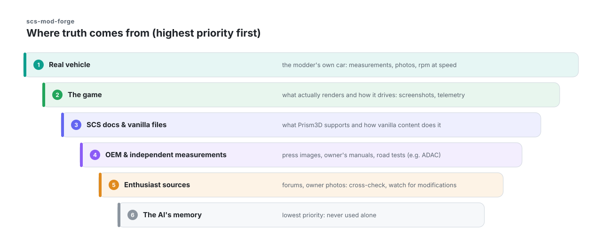

# 01 · Architecture

This document explains **what the parts are**, **what each one is responsible for**, **what passes between them**, and **where mistakes get caught**. If you only read one document in this repository, read this one.

<picture>
  <source media="(prefers-color-scheme: dark)" srcset="assets/architecture-dark.svg">
  
</picture>

---

## 1. The problem this architecture solves

An AI agent connected to Blender is a strong **executor**: it can model, unwrap, write Python and edit definition files tirelessly. For realistic modding it has four structural weaknesses:

| Weakness | What it looks like in practice | Architectural answer |
|---|---|---|
| **It sees Blender, not the game** | Looks perfect in the viewport; in game: sawtooth edges, missing faces, black mirrors, moiré | The **Game** is a role, and acceptance requires in-game screenshots |
| **It fills gaps with plausible guesses** | "Remembers" how a Civic dashboard looks; invents `.sii` attributes that look right and do nothing | A **Director** supplies inspected references and engine documentation *before* work starts |
| **It declares success early** | "Implemented the frit band", which never appeared in game | **Acceptance gates** tied to evidence, plus an A/B-or-revert rule |
| **It patches symptoms** | A black mirror gets a third new material instead of an investigation | **Diagnose-first** steps: colour-tag builds, audits, raycasts; escalation after two failures |

Each weakness gets a role, an artifact or a rule. Nothing depends on the agent "trying harder".

---

## 2. Three layers

### 2.1 Truth layer: where facts come from

| Source | Examples | Who consults it | Authority |
|---|---|---|---|
| **Real vehicle** | tyre sidewall, rpm at 130 km/h, headliner colour, owner's photos | Modder (on request) | Highest. Overrides internet specs |
| **Real-world references** | OEM press images, owner's-manual diagrams, independent road tests, review galleries, in-use photos | Director | High, once inspected and checked for variant/market |
| **Engine truth** | SCS Modding Wiki, vanilla game files, SCS Blender Tools docs | Director (to phrase work), Builder (for syntax) | Absolute for *how* something can be built |
| **Measured behaviour** | in-game screenshots, telemetry (speed vs time) | Builder, Director | The acceptance evidence |

<picture>
  <source media="(prefers-color-scheme: dark)" srcset="assets/sources-of-truth-dark.svg">
  
</picture>

When two sources disagree, the higher one wins. In the Civic project, published US gear data gave ~3 000 rpm at 130 km/h in 6th, while an independent EU test measured ~3 100 rpm. The rule makes the next step obvious: the owner reads the tachometer on the real car, and that number sets the final drive.

### 2.2 Role layer: who does what

Four roles, in the order work flows. One person can play Modder; the Director and Builder can even be the same AI product in different sessions. What matters is that the **responsibilities and hand-offs stay separate**.

### 2.3 Artifact layer: what passes between roles

Every hand-off is a **file**, so it can be reviewed, versioned and reused. See §4.

---

## 3. The roles in detail

### 👤 Modder: owner and QA

| | |
|---|---|
| **Responsible for** | Playing and noticing; describing defects in plain words; taking the requested in-game views (F12); confirming specs on the real vehicle; accepting or rejecting a round |
| **Inputs** | Round reports, A/B comparisons, questions about the real vehicle |
| **Outputs** | Bug screenshots + one line per defect; in-game views V1–V5; owner's measurements |
| **Tools** | The game, a phone/tape measure/OBD dongle for the real car |
| **Must not** | Accept a round on the strength of Blender renders |

The modder's complaints don't have to be technical. "The black covers everything when I look sideways" gave the Director enough to suspect an opaque exterior-model door surface.

### 🧭 Director: research and direction

| | |
|---|---|
| **Responsible for** | Triage (what exactly is wrong, likely causes); finding and **inspecting** references; checking what Prism3D supports; writing one **round prompt** per round; reviewing the next batch of screenshots with fresh eyes |
| **Inputs** | Screenshots + complaints; previous round reports |
| **Outputs** | Reference table; round prompt (`.md`); engine-truth notes |
| **Tools** | A chat assistant with web search, a browser (to open image galleries and wiki pages) and the ability to look at images |
| **Must not** | Invent engine features; link references it hasn't looked at; touch mod files |

Typical catches that only happen when references are actually inspected: an aftermarket ring on a "tweeter" photo, a market-specific camera under a mirror, a 7th-generation car in a 10th-generation search result.

### 🛠️ Builder: execution

| | |
|---|---|
| **Responsible for** | Diagnosing before changing; measuring instead of eyeballing; modeling, materials, UVs, export; `.sii` definitions following vanilla patterns; asking for specific in-game views; comparing screenshots with references; keeping or reverting each change |
| **Inputs** | Round prompt; standing rules (`CLAUDE.md`); vanilla data; references |
| **Outputs** | The mod; diagnostic builds; measurement files; A/B comparisons; round report |
| **Tools** | Claude Code, Blender via an MCP server, SCS Blender Tools, the Python and Blender tools in this repo |
| **Must not** | Mark anything done without in-game evidence; use attributes it can't cite; touch systems the round marks as working; copy assets from other mods |

### 🎮 Game: ground truth

| | |
|---|---|
| **Responsible for** | Showing what really happens: rendering, culling, triangulation, lamps, mirrors, dashboard UI, physics |
| **Produces** | Views V1–V5 (via the Modder), telemetry |
| **Why it is a role** | Treating the game as an actor with its own output keeps everyone honest. "Done" means "the game shows it" |

---

## 4. Artifact contracts

| Artifact | Owner | Format | Lifecycle | Contract (what makes it valid) |
|---|---|---|---|---|
| Bug report | Modder | screenshots + text | per round | One line per defect; standard view if possible |
| Reference table | Director | Markdown table ([template](../templates/reference-table.md)) | per component, reused | Every row inspected; variant/market and caveats noted; scale anchors listed |
| Round prompt | Director | Markdown ([template](../templates/round-prompt.md)) | per round, archived | Per item: *now / real / diagnose / build / accept*; engine-true; protects working systems; lists owner questions |
| Standing rules | Modder | `CLAUDE.md` ([template](../templates/CLAUDE.md)) | per project | Names game + engine; evidence rules; standard views; no invented attributes |
| Diagnostic build | Builder | `*_diag` mod + `diag_colors.md` | throw-away | Never shipped; colour map filled in |
| Measurements | Builder | JSON/MD + annotated images | per component | Derived from tools, with the scale anchor stated |
| In-game views | Modder | F12 PNGs | per iteration | Same head position, named V1–V5 |
| A/B comparison | Builder | side-by-side / overlay PNGs | per change | Before, after and reference in one image |
| Round report | Builder | Markdown | per round | Diagnosis, files changed, evidence, open differences, owner questions |

---

## 5. Control points: where mistakes are caught

The architecture is a series of **gates**. Each one stops a specific class of error before it becomes expensive.

| Gate | When | Checks | Stops |
|---|---|---|---|
| **G1 · Reference gate** | before the prompt | every reference opened, variant correct | modeling the wrong trim/market, aftermarket parts |
| **G2 · Engine gate** | before the prompt | mechanism exists in wiki/vanilla | requirements that are impossible in Prism3D (e.g. shader code) |
| **G3 · Diagnosis gate** | before building | root cause written; audit clean; colour-tag if unclear | patching symptoms; editing the wrong file |
| **G4 · Evidence gate** | after each change | in-game view next to reference; A/B | "done in Blender, broken in game"; regressions |
| **G5 · Acceptance gate** | end of round | [checklist](../templates/acceptance-checklist.md) | silently dropped requests; shipped diagnostic builds |

**Escalation rule:** if the same item fails G4 twice, the Builder stops retrying. It runs colour-tag diagnostics and studies how a working mod achieves the effect (learning the technique, never copying assets). If the engine really can't do it, the Builder reports the evidence and waits for the Modder's decision.

---

## 6. Why separate Director and Builder?

1. **Context hygiene.** Reference hunting is mostly dead ends. The Director absorbs that noise and hands over a short, verified table.
2. **Independent review.** The agent that built something tends to see what it intended to build. The Director reviews screenshots without that bias.
3. **Different strengths.** Browsing galleries and reading documentation versus manipulating files, running Python and driving Blender.
4. **A paper trail.** Round prompts are documents: reviewable, reusable for the next vehicle, and a record of how the method improved (see the [case study](../examples/civic-fc/README.md)).

You can run both roles with one assistant in two separate conversations. Don't merge them into one long session.

---

## 7. Boundaries

- **Legal.** References are linked, never redistributed. Other mods may be studied to learn a technique, never copied. Sounds come only from your own recordings or properly licensed sources.
- **Engine.** If neither the wiki nor vanilla files show a mechanism, the prompt says: find out, report, propose the closest alternative, wait for approval.
- **Look-changing fallbacks** (e.g. a static mirror instead of a live one) are the Modder's decision.

---

## 8. Adapting the architecture

| Your situation | Adaptation |
|---|---|
| No access to the real vehicle | Drop level 1 of the truth hierarchy. Rely on independent measured tests, and mark remaining specs as assumptions in the round report |
| A truck instead of a car | Same layers. Vanilla trucks are much closer templates, so G2 gets easier |
| ATS instead of ETS2 | Same method. Check per-game differences on the wiki (units, IDs added in specific versions) |
| No browser for the Director | Use web search plus images the Modder downloads. G1 still requires *looking* at each one |
| Team of modders | One Director per vehicle; Builders per area (interior / exterior / physics / sound), each with its own round prompts |
