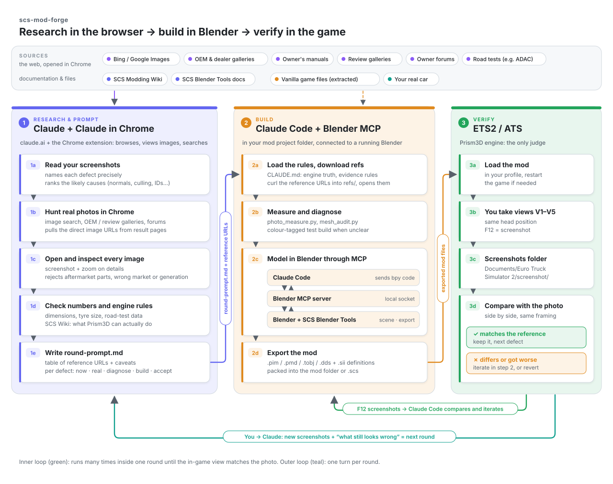

# 01 · Architecture

The method uses **two Claude agents with different tools**, plus the game and you.

| Component | Concretely | Main job |
|---|---|---|
| **You** | the modder, playing ETS2/ATS | Say what looks wrong; take in-game screenshots; confirm facts about the real vehicle |
| **Claude + Claude in Chrome** | Claude (claude.ai) with the Chrome extension, so it can browse, run small scripts on pages, take screenshots and zoom | Research real photos and data; write the prompt |
| **Claude Code + Blender MCP** | Claude Code in your mod project folder, with a Blender MCP server connected to a running Blender (with SCS Blender Tools) | Measure, model, export |
| **ETS2 / ATS** | the game, running your mod | Show what really renders and drives |

<picture>
  <source media="(prefers-color-scheme: dark)" srcset="assets/architecture-dark.svg">
  
</picture>

---

## 1. Why two agents?

Claude Code connected to Blender is an excellent **builder**. Left alone, it has four weaknesses:

| Weakness | What it looks like | Fix in this architecture |
|---|---|---|
| It sees Blender, not the game | Perfect in the viewport; in game: sawtooth edges, missing faces, black mirrors | The game is the judge: acceptance = in-game screenshot next to a real photo |
| It works from memory | "Remembers" a generic dashboard; invents `.sii` attributes | **Claude in Chrome** finds and **inspects real photos** and documentation first |
| It declares success early | "Frit band added", but it never appeared in game | Evidence gates + A/B-or-revert |
| It patches symptoms | Third new material on a black mirror | Diagnose-first steps written into the prompt |

Claude in Chrome is the right tool for the research half:

- **It browses like you do.** It can open image search, OEM and dealer galleries, review sites, forums and the SCS wiki in your browser, including pages that plain web fetching can't render.
- **It can look.** It opens each candidate image, takes a screenshot and zooms on the detail that matters: the number of vent louvers, the label on a button, how the tachometer looks *while driving*.
- **It can extract.** A small script on a results page lists the direct image URLs and source pages, so the prompt can carry links Claude Code can download.

Claude Code is the right tool for the build half: it works in your project files, runs Python, and drives Blender through MCP.

Keeping them separate also keeps both contexts clean. Research is full of dead ends (aftermarket parts, wrong market, wrong generation); the builder only receives the verified result.

---

## 2. The hand-offs

Everything that passes between components is a file or a screenshot. Nothing relies on memory.

| # | From → to | What | Format |
|---|---|---|---|
| A | You → Claude in Chrome | Screenshots of what looks wrong + one line each, using the [research brief](../templates/research-brief.md) | images + text |
| B | Claude in Chrome → you → Claude Code | **`round-prompt.md`**: verified photo URLs + per defect *now · real · diagnose · build · accept* | Markdown ([template](../templates/round-prompt.md)) |
| C | Claude Code → Blender | `bpy` commands through the MCP server | MCP tool calls |
| D | Blender → mod folder | `.pim/.pmd/.pit/.pic`, `.tobj` + `.dds`, `.sii` | SCS Blender Tools export |
| E | Claude Code → you | "Take views V2 and V4, daytime" | text |
| F | Game → Claude Code | F12 screenshots from `Documents/Euro Truck Simulator 2/screenshot/` (read directly or sent by you) | PNG |
| G | Claude Code → you | Round report: cause, changes, side-by-side comparisons, open points | Markdown + images |
| H | You → Claude in Chrome | Next round: new screenshots + "what still looks wrong" | images + text |

Hand-offs **C → F** form the **inner loop** (many times per round). **A → H** is the **outer loop** (once per round).

---

## 3. Component details

### 3.1 Claude + Claude in Chrome (research & prompt)

| | |
|---|---|
| **Inputs** | Your screenshots and complaints; the previous round report |
| **Uses** | Chrome: image search, galleries, manuals, forums, road tests, SCS wiki. Web search for specs |
| **Produces** | `round-prompt.md` with a verified reference table |
| **Must** | Open every image it links; note caveats (market, trim, aftermarket); phrase every requirement in what Prism3D supports; say what not to touch |
| **Must not** | Link images it hasn't looked at; invent engine features |

Step by step (diagram steps 1a–1e) and the browser techniques: **[docs/10](10-research-with-claude-in-chrome.md)**.

### 3.2 Claude Code + Blender MCP (build)

| | |
|---|---|
| **Inputs** | `round-prompt.md`; standing rules in `CLAUDE.md`; extracted vanilla files |
| **Uses** | Blender via MCP (runs `bpy`, inspects the scene, viewport screenshots); SCS Blender Tools; the Python tools in this repo; `curl` for the reference URLs |
| **Produces** | The mod; measurement files; diagnostic builds; side-by-side comparisons; round report |
| **Must** | Download and open the references before modeling; diagnose before changing; ask for specific in-game views; keep or revert by comparison |
| **Must not** | Mark anything done from Blender renders; use attributes it can't cite; copy assets from other mods |

Setup and a typical session: **[docs/11](11-build-with-claude-code-and-blender-mcp.md)**.

### 3.3 ETS2 / ATS (verify)
The game is treated as a component with its own output. Fixed views V1–V5 (same head position every time) make screenshots comparable across iterations ([docs/06](06-verification.md)).

### 3.4 You
You are the only one who sees the game and the real car. Plain-language complaints are enough ("the black covers half the side window"); Claude in Chrome turns them into technical defects. When a number matters (tyre size, rpm at 130 km/h, headliner colour), your measurement beats any website.

---

## 4. Where truth comes from

<picture>
  <source media="(prefers-color-scheme: dark)" srcset="assets/sources-of-truth-dark.svg">
  
</picture>

When sources disagree, the higher one wins. Example from the Civic: published US gear data gives ~3 000 rpm at 130 km/h in 6th, while an EU road test measured ~3 100 rpm. The owner reads the tachometer on the real car, and that reading sets the final drive.

---

## 5. Control gates: where mistakes are caught

| Gate | Where | Check | Stops |
|---|---|---|---|
| **G1 · Photo gate** | step 1c | every linked image opened and inspected | wrong trim/market, aftermarket parts, wrong generation |
| **G2 · Engine gate** | step 1d | mechanism exists in the wiki or vanilla files | impossible requirements (e.g. shader code) |
| **G3 · Diagnosis gate** | step 2b | cause written down; mesh audit clean; colour-tag build if unclear | patching symptoms, editing the wrong file |
| **G4 · Evidence gate** | step 3d | in-game view next to the photo; A/B | "done in Blender, broken in game"; regressions |
| **G5 · Acceptance gate** | end of round | [checklist](../templates/acceptance-checklist.md) | dropped requests, shipped test builds |

**Escalation:** if the same item fails G4 twice, Claude Code stops retrying. It colour-tags to find the real source and studies how a working mod does it (learning the technique, never copying assets). If the engine really can't do it, it reports the evidence and waits for your decision.

---

## 6. Variations

| Situation | Adaptation |
|---|---|
| No Chrome extension | Claude with web search + images you download and attach. G1 still means *looking* at each one |
| No access to the real vehicle | Use independent measured tests and mark the remaining specs as assumptions |
| A truck instead of a car | Same pipeline; vanilla trucks are much closer templates, so G2 is easier |
| ATS instead of ETS2 | Same pipeline; check per-game differences on the wiki |
| A team | One research thread per vehicle; separate Claude Code sessions per area (interior, exterior, physics, sound) |
