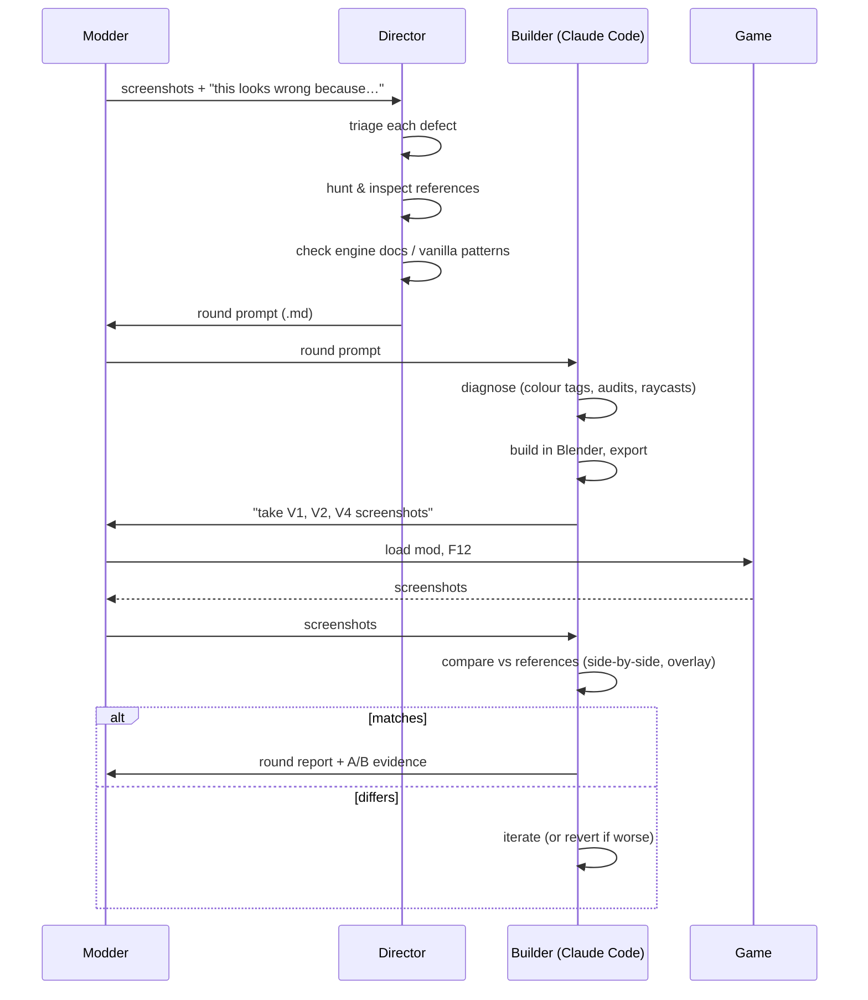

# 01 · Architecture

This document explains **who does what**, **what flows between them** and **why the work is split this way**.

## 1. The problem the architecture solves

An AI agent connected to Blender is a strong *executor*. Left alone, it has four weaknesses that matter for realistic modding:

1. **It optimizes for what it can see.** It sees Blender, not the game. Shading, culling, triangulation, mirror cameras, mipmaps and lamp masks only show their real behavior in Prism3D.
2. **It fills gaps with plausible guesses.** Without references it "remembers" how a car interior looks. Without documentation it invents `.sii` attributes that look right and do nothing.
3. **It declares success early.** "Implemented" usually means "I wrote something", not "it works in game".
4. **It patches symptoms.** A black mirror gets a new material instead of an investigation into *which mesh* is black.

The architecture puts a role and an artifact in front of each weakness.

## 2. Roles

### 👤 The Modder (owner and QA)
- Plays the game and takes the **in-game screenshots** (F12) that are the only accepted evidence.
- States what bothers them in plain language. "The mirror shows the road in front" is a perfect bug report.
- **Owns the real-world truth.** If the modder has access to the real vehicle, they confirm tyre size, rpm at a given speed, headliner colour and similar facts. Internet specs are hypotheses until then.
- Decides when a round is accepted.

### 🧭 The Director (research and prompt author)
A chat assistant with web search and a browser. It never touches the mod files. Its job is to turn complaints into **work orders that cannot be passed without doing the work**.
- **Triage**: looks at each screenshot and names the defect precisely (e.g. "the glass is rendered but the housing faces are missing; looks like flipped normals or a culled part").
- **Reference hunt**: finds the best real references for each component (OEM press images, owner's-manual diagrams, close-ups, night shots, independent road-test measurements) and *looks at them* before linking them.
- **Engine-truth check**: reads SCS documentation and phrases every requirement in terms of what Prism3D supports.
- **Round prompt**: writes one structured prompt per round (see [04](04-round-prompts.md)).

### 🛠️ The Builder (Claude Code + Blender MCP)
- Executes the round: modeling, UVs, materials, export with SCS Blender Tools, `.sii` definitions.
- Uses **tools instead of eyes**: OpenCV to measure from photos, raycasts to measure gaps, mesh audits, diagnostic colour builds.
- Asks the modder for **specific screenshots** (fixed views) and compares them with the references.
- Reports diagnosis, changes, evidence and what is still different.

### 🎮 The Game (ground truth)
ETS2 / ATS with the mod loaded. Nothing is "done" until it is right here.

## 3. Artifacts

| Artifact | Produced by | Consumed by | Purpose |
|---|---|---|---|
| Bug screenshots + complaint | Modder | Director | Input of a round |
| Reference table | Director | Builder | Real photos/data per component, each one inspected |
| Round prompt | Director | Builder | The work order (constraints, refs, steps, acceptance) |
| `CLAUDE.md` standing rules | Modder (from template) | Builder | Rules valid in every round |
| Diagnostic build (`_diag`) + colour map | Builder | Modder → Builder | Identify which file/mesh produces a pixel |
| Measurement files (`*_measurements.md`, overlays) | Builder | Builder, Director | Proportions from photos, gap reports |
| In-game screenshots V1–V5 | Modder | Builder, Director | Acceptance evidence |
| A/B comparison images | Builder | Modder | Before/after next to the reference |
| Round report | Builder | Modder, Director | Diagnosis, changes, evidence, open differences |

## 4. Data flow of one round

## 5. Why split Director and Builder?

You *could* let one agent do everything. Separating the roles still pays off:

- **Context hygiene.** Reference hunting produces many dead ends (aftermarket parts, wrong generation, wrong market). The Director absorbs that noise. The Builder gets a clean, verified table.
- **Independent judgment.** The Director reviews the Builder's output (the modder's screenshots) with fresh eyes. An agent grading its own work tends to see what it intended to build.
- **Different tools.** Browsing image galleries and reading wiki pages is the Director's strength. File manipulation, Python and Blender belong to the Builder.
- **A paper trail.** Each round prompt is a document. You can publish it, reuse it for another vehicle and see how the method evolved (see the [case study](../examples/civic-fc/README.md)).

## 6. Where truth comes from (priority order)

1. **The modder's real vehicle** (measurements, photos, behaviour).
2. **The game** (what actually renders and how it drives).
3. **SCS documentation and vanilla game files** (what the engine supports and how).
4. **OEM material and independent measurements** (press photos, owner's manuals, road tests such as ADAC).
5. **Enthusiast sources** (forums, owner photos), cross-checked.
6. **The AI's memory.** Lowest priority, never used alone.

## 7. Boundaries

- The Builder never redistributes third-party assets (photos, sounds, other mods' models). Other mods may be **studied to learn a technique** (e.g. how someone wired an interior mirror camera), never copied.
- The Director never invents engine features. If the wiki and vanilla files don't show a mechanism, the prompt says "find out whether this is possible; if not, report and propose the closest alternative; wait for approval".
- The modder approves every fallback that changes the look (e.g. a static mirror instead of a live one).
