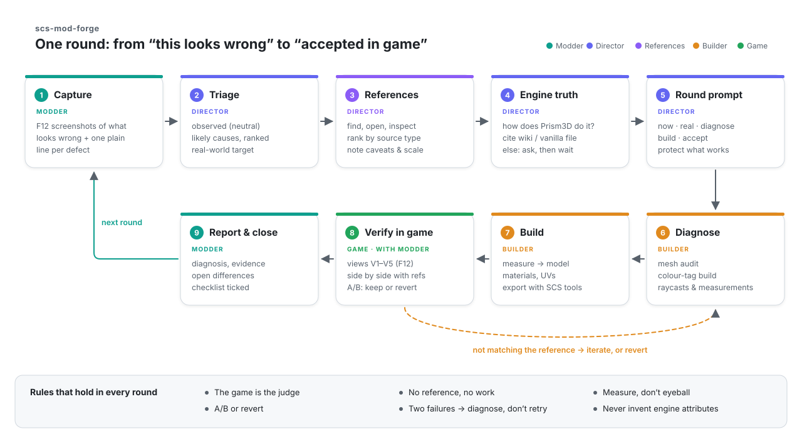

# 02 · The round workflow

A **round** is one cycle from "this looks wrong" to "accepted in game". Keep rounds small: 3–6 defects. Big rounds dilute attention and make it hard to tell which change broke what.

<picture>
  <source media="(prefers-color-scheme: dark)" srcset="assets/round-loop-dark.svg">
  
</picture>

Stages 1–5 belong to the Modder and the Director and produce **one round prompt**. Stages 6–8 are the Builder's loop with the game: diagnose, build, verify, and back to diagnose (or revert) until the in-game views match the references. Stage 9 closes the round with the acceptance checklist.

## Stage 0: Standing setup (once per project)

- Copy [`templates/CLAUDE.md`](../templates/CLAUDE.md) into the mod project root and adapt it (game, vehicle, paths).
- Extract vanilla data (`def.scs`, `base.scs`, DLC archives) with the SCS extractor into a read-only folder the Builder can search.
- Define your **standard views** V1–V5 (see [06](06-verification.md)) and write them in `CLAUDE.md`.
- Create `refs/`, `renders/`, `tools/`, `OLD_*` collections in the `.blend`.

## Stage 1: Capture (Modder)

- Play. When something looks wrong, take an F12 screenshot from a standard view if possible.
- Write one line per defect, in your own words. Emotion is fine; specificity is gold: "the black covers half of the side window when I look left".

## Stage 2: Triage (Director)

For each defect write three things:

1. **Observed**: what is visible, described neutrally ("glass floats with no housing; a white sliver where the housing should be").
2. **Likely causes**, ranked ("flipped normals / single-sided faces; part not in the interior-visible variant; leftover mesh").
3. **Real-world target**: what the real part looks like, from references (stage 3).

Also look for **defects the modder didn't mention but will notice next** (white door handle, ghost frame) and add them as small items or a "bonus" section.

## Stage 3: References (Director)

See [03](03-references.md). Output: a reference table where every link has been **opened and looked at**, with a note on what it shows and its caveats ("India-spec: ignore the camera under the mirror").

## Stage 4: Engine-truth check (Director)

See [05](05-prism3d-constraints.md). For every requirement ask: *how does Prism3D do this?* Link the wiki page or name the vanilla pattern. If unknown, the prompt tells the Builder to find out first and report before building.

## Stage 5: Round prompt (Director)

See [04](04-round-prompts.md). One Markdown file, numbered sections, one section per defect, each with *now / real / steps / acceptance*.

## Stage 6: Diagnose (Builder)

Before changing anything:

- Run the mesh audit on the affected objects.
- If it is unclear which file or mesh produces a visible defect, make a **colour-tagged diagnostic build** (see [06](06-verification.md)).
- Write the diagnosis down. "Cause: interior mirror slot camera faces +Z (forward)" beats "fixed mirror".

## Stage 7: Build (Builder)

- Measure from references with tools; model from contours, not from memory.
- Keep old parts in an `OLD_vN` collection; never delete history mid-round.
- Export with SCS Blender Tools; follow vanilla patterns for `.sii`.

## Stage 8: Verify in game (Builder ↔ Modder)

- The Builder asks for **named views** ("V2 and V3, daytime").
- The modder sends the screenshots (or the Builder reads the game's screenshot folder if it has access).
- The Builder places each screenshot next to its reference, lists the differences and iterates.
- **A/B rule**: if "after" is not clearly closer to the reference than "before", revert.

## Stage 9: Report and close

The round report contains:

1. diagnosis per defect,
2. files changed,
3. evidence (A/B images next to references),
4. what is still different and why,
5. what the modder must check or measure on the real vehicle.

The round is closed when every item in the [acceptance checklist](../templates/acceptance-checklist.md) is ticked or explicitly deferred.

## Anti-patterns we learned to forbid

| Anti-pattern | Rule that replaced it |
|---|---|
| "Done" based on Blender renders | No acceptance without in-game screenshots |
| Same fix tried three times | After two failures, switch to colour-tag diagnosis and study a working mod |
| Fixing everything at once | Fixed order inside the round; A/B per item |
| Touching working systems "while I'm here" | "Don't touch what works" clause in every round |
| Assuming the engine (e.g. writing shader code for a game whose mods can't run code) | Engine named in `CLAUDE.md`; engine-truth check before each round |
