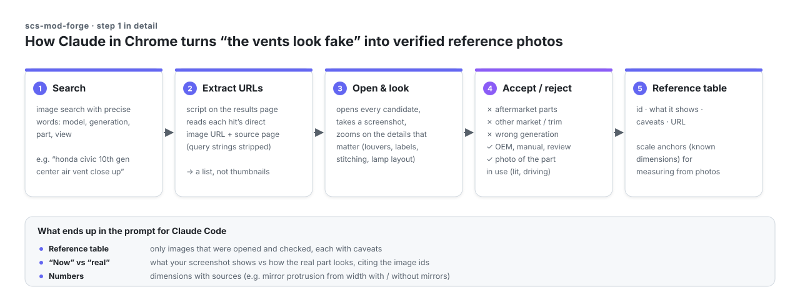

# 10 · Research with Claude in Chrome

This is the playbook for step ① of the [architecture](01-architecture.md): turning "this looks fake" into a list of **verified real photos** and a prompt Claude Code can execute.

<picture>
  <source media="(prefers-color-scheme: dark)" srcset="assets/research-step-dark.svg">
  
</picture>

## Setup

- Install **Claude in Chrome** and use it with Claude, so Claude can open pages, run small scripts on them, take screenshots and zoom.
- Start each round with the [research brief](../templates/research-brief.md): your screenshots, one line per defect, the exact vehicle (model, generation, year, market, trim, engine, gearbox) and the game.
- Claude works in a browser tab of yours. Don't type in that tab while it works.

## 1. Search with precise words

Generic searches return generic (and often wrong) cars. Always include **model + generation code or years + part + view**:

| Weak | Strong |
|---|---|
| civic dashboard | honda civic 10th gen center air vent close up hazard |
| civic gauges | honda civic 2020 instrument cluster km/h close up |
| civic mirror | honda civic 10th gen rear view mirror view rear window headrests |

Variations worth running for every part: **close-up**, **from the driver's seat**, **at night / lit**, **while driving**, **owner's manual**.

## 2. Extract direct image URLs

Thumbnails in a results page are useless for Claude Code. On an image-search results page, Claude runs a small script that reads each hit's metadata and returns the **direct image URL and the source page**, with query strings removed (they often carry tracking data, and the extension may refuse to show them). The result is a plain list Claude can open one by one and later put in the prompt.

Other reliable sources of direct URLs:

- **Dealer and OEM galleries**: often hosted on predictable storage paths with descriptive file names (e.g. `.../2020-civic-sedan/gallery/02-...-Interior-Cockpit-Passenger-Side.jpg`).
- **Review galleries with numbered files**: once one image URL is known (`...-civic-16.jpg`), neighbours (`-17`, `-18`…) are usually the same car from other angles, often including night shots, the driver's view and wheel close-ups.
- **Studio "stills" sets**: numbered interior/exterior angles of the same trim.
- **Owner's-manual pages and diagrams**: the authority for layouts (warning lamps, switch labels).

## 3. Open and look: every image, every time

Claude opens each candidate and takes a screenshot. When details matter, it **zooms** on a region: louver count, button labels, stitching colour, lamp segments, gauge numbers. This is gate **G1**. Things caught only by looking:

- an aftermarket ring around a tweeter;
- a market-specific camera under a side mirror;
- a 7th-generation car in a 10th-generation search;
- the right half of a "before/after" image being an aftermarket carbon cover;
- a CVT car (P-R-N-D-S lever, paddles) when the target is a manual.

## 4. Accept or reject

| Accept | Reject or mark with a caveat |
|---|---|
| OEM press / dealer photos of the right generation | aftermarket or tuned parts |
| owner's-manual diagrams | other market or trim (unless the part is identical) |
| professional review galleries | other generation or facelift stage |
| owner photos of the part **in use** (lit, driving, reflecting) | heavy watermarks hiding the detail |
| independent measured tests | listings without a clear source |

Some sites block direct image loading (hotlink or bot protection). Link the **gallery page** instead and tell Claude Code to open it there.

## 5. Numbers

Alongside photos, Claude collects numbers that become **scale anchors** and **targets**:

- dimensions: width with and without mirrors (→ mirror protrusion), wheelbase, track, turning circle;
- tyre size of the exact trim (→ wheel radius, gear speeds);
- measured performance for the exact variant (e.g. in-gear 60–100 km/h times from a road test);
- engine rules: the relevant SCS wiki page (dashboard IDs, lamp mask, mirrors, sound).

Each number gets its source and the exact variant it applies to.

## 6. Write the prompt

Claude fills the [round prompt template](../templates/round-prompt.md):

- **References table**: id · what it shows · caveats · URL. Only inspected images.
- Per defect: **Now** (what your screenshot shows) · **Real** (how the real part looks, citing reference ids, with proportions, materials and behaviour) · **Diagnose** (likely causes in order) · **Build** (measurable steps) · **Accept** (which in-game views next to which references, which numbers).
- What **not** to touch, carried-over open items, and questions for you about the real car.

You review it, then paste it into Claude Code.

## 7. After the round

When Claude Code reports back, bring the new screenshots to the same Claude conversation. With the previous prompt still in context, Claude can see what was fixed, what regressed and what was silently dropped, and the next prompt gets sharper.
